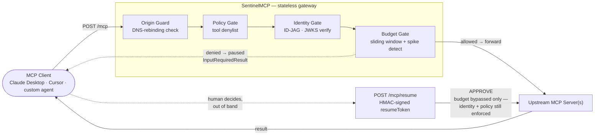

<div align="center">
  <h1>🛡️ SentinelMCP</h1>
  <p><b>Stateless enterprise policy firewall & token-cost proxy for MCP.</b></p>
  <p>Drop it in front of any Model Context Protocol server. Every tool call gets checked for identity, policy, and budget before it reaches your infrastructure — no database, no sticky sessions, nothing new to operate at 3am.</p>

  <!-- 👇 THE 1-COMMAND DEMO GIF GOES HERE -->
  

  <p>
    <code>docker run --rm -it ghcr.io/asctttt/sentinel-mcp:demo</code>
  </p>
</div>

<p align="center">
  <a href="https://github.com/asctttt/sentinelmcp/actions/workflows/ci.yml"></a>
  <a href="LICENSE"></a>
  
  <a href="https://buy.polar.sh/YOUR_CHECKOUT_LINK"></a>
</p>

<p align="center">
  <a href="https://github.com/asctttt/sentinelmcp/actions/workflows/ci.yml"></a>
  <a href="LICENSE"></a>
  
</p>


---

## The 2-minute problem

MCP made it trivial to wire an LLM agent up to real tools — databases, payment APIs, internal services. It did **not** ship a policy layer. If you've run an MCP server in production, you've probably already hit one of these:

**Runaway loops.** An agent gets stuck retrying a failing call, or a bad prompt sends it into a call-and-recall spiral. Nothing in the MCP spec stops it. You find out from the bill, not an alert.

**Token budgets that don't exist until they explode.** Nothing in a typical agent loop stops it from calling the same expensive tool hundreds of times in an hour. The common failure mode: a $40/day budget quietly becomes a $40k/month bill, and the first signal anyone gets is the invoice.

**DNS-rebinding and confused-deputy risk.** The Streamable HTTP transport spec requires Origin validation for exactly this reason — a malicious page can rebind DNS to reach a local MCP server your browser would otherwise block. Most self-hosted servers don't implement it. Stack a compromised or injected tool result on top, and "just add an MCP server" is a bigger attack surface than most teams have budgeted time to secure.

SentinelMCP won't stop a model from being tricked — no proxy can. What it does is make sure a tricked or runaway agent can't reach a tool it isn't allowed to call, blow through a budget nobody approved, or keep running once the numbers look wrong — without a human getting a say.

---

## Key features

### Zero-trust security
- **Origin validation** on every request — the DNS-rebinding mitigation the Streamable HTTP spec requires and most self-hosted servers skip. Loopback-only by default; explicit allowlist for anything else, override not extend.
- **ID-JAG identity enforcement** — real JWKS-backed JWT verification, asymmetric algorithms only (no HMAC-downgrade path), including the `resource` claim binding that closes the confused-deputy hole: a token issued for one MCP server can't be replayed against another.

### Token economics
- **Structural token estimation** — walks the actual JSON-RPC payload instead of `length / 4`, pricing natural-language content and JSON structure at different, calibrated rates. Input measured exactly; output projected from a per-tool rolling average and trued up against the real response after every call.
- **7-day sliding-window budgets** per team, enforced against a fixed-memory circular buffer (168 hourly buckets) — bounded, no per-request log to prune, no unbounded growth under load.
- **Spike detection independent of the hard cap** — a sudden burst against a team's own recent baseline gets caught even while the cumulative total is nowhere near the limit. Catches the exponential-growth pattern before the raw budget does.

### Human-in-the-loop, not hard failure
- A budget breach doesn't 500 the call. It returns `InputRequiredResult` — a normal JSON-RPC *success* — carrying the projected overrun, the run-rate spike, and an HMAC-signed, request-bound `resumeToken`.
- `POST /mcp/resume` with `{ resumeToken, decision: "APPROVE" | "DENY", originalRequest }` lets a human clear it. The token is bound to the exact call via a canonical-JSON hash of the request — approve *this* wire transfer, not whatever an agent decides to substitute next.
- Delivery is transport-aware: the pause notice reaches the client over whichever channel the original call used.

### Protocol support
- **Streamable HTTP** — the current MCP standard (spec 2025-03-26+), and the primary path.
- **Legacy HTTP+SSE** (spec 2024-11-05) for backward compatibility with clients that haven't migrated. Not the default; don't build new integrations against it.

---

## Quickstart

```bash
git clone https://github.com/your-org/sentinelmcp.git
cd sentinelmcp
npm install
cp .env.example .env
```

Six required values in `.env` — everything else ships with a sane default:

| Variable | What it is |
|---|---|
| `MCP_UPSTREAM_URL` | The real MCP server SentinelMCP forwards allowed calls to |
| `JWKS_URI` | Your IdP's JWKS endpoint (Okta, Auth0, Azure AD, …) |
| `ID_JAG_ISSUER` | Expected `iss` claim on incoming ID-JAG tokens |
| `ID_JAG_AUDIENCE` | Expected `aud` claim |
| `ID_JAG_RESOURCE` | This gateway's resource identifier — the anti-confused-deputy binding |
| `HMAC_SECRET` | 32+ random chars signing resume tokens — `openssl rand -base64 32`. **Must be identical across every replica**, or resume verification breaks depending on which one handles a given call. |

```bash
npm run build && npm start   # production
# or, for local iteration:
npm run dev                  # tsx watch
```

Confirm it's alive:

```bash
curl http://localhost:8080/healthz
```

---

## How it fits



SentinelMCP sits in front of one or more upstream MCP servers as a reverse
proxy. Every gate runs on every request; a denial short-circuits before the
call ever reaches your tools. Only the budget gate can be bypassed, and only
by an explicit, signed, single-call human approval — identity and policy are
re-checked even on resume.

Two of the five subsystems keep state in memory (SSE session tracking and
the budget ledger) — the request/response path itself is stateless and
horizontally scalable behind a plain load balancer. See
[`docs/ENGINEERING.md`](docs/ENGINEERING.md) for exactly which pieces, and
what that means for running more than one replica.

---

## Quality

- **63 tests, 19 suites** — `npm test`. Unit coverage for the token
  estimator, the sliding-window budget algorithm (spike detection included,
  verified with an injectable clock rather than waiting real days), and the
  HMAC token service (round-trip, tampering, forged secrets, canonical-hash
  binding). Integration coverage runs the full request pipeline through
  `fastify.inject()` against a real, ephemeral-port mock identity provider
  and mock upstream — no stubbed JWT verification, no mocked crypto.
- **Strict TypeScript** — `strict`, `noUncheckedIndexedAccess`,
  `noImplicitOverride`. No `any` in the source tree.
- **Zero test-framework dependencies** — built on Node's own `node:test`.
- CI runs typecheck, the full suite, and a production build on every push,
  against Node 20 and 22.

The full engineering log — what's verified, every bug found during
development and how it was fixed, and every known limitation stated
plainly rather than glossed over — lives in
[`docs/ENGINEERING.md`](docs/ENGINEERING.md).

---

## SentinelMCP Pro & Enterprise Support

SentinelMCP's core gateway is free and MIT-licensed. For teams running multiple replicas in production or requiring compliance audit trails, **SentinelMCP Pro** unlocks enterprise capabilities via a single `SENTINEL_LICENSE_KEY` environment variable:

| Feature | Community (MIT) | SentinelMCP Pro ($199/mo) |
|---|---|---|
| Origin Guard, Policy Gate & ID-JAG Verification | Included | Included |
| 168-Bucket Sliding Window & Spike Detection | Single Instance | Multi-Replica / Cluster Ready |
| Structured SIEM / Datadog Audit Log Export | — | Included |
| Slack / PagerDuty Budget Breach Webhooks | — | Included |
| Priority Security Patches & Architecture Support | Community Issues | Direct Engineering Support |

👉 **[Purchase a SentinelMCP Pro License Key via Polar.sh](https://buy.polar.sh/YOUR_CHECKOUT_LINK)**

---

## License

[MIT](LICENSE)
